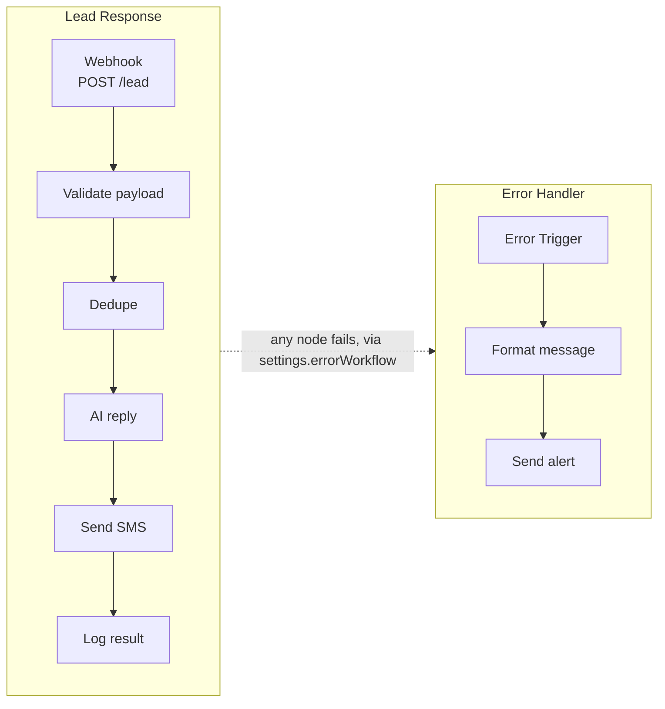
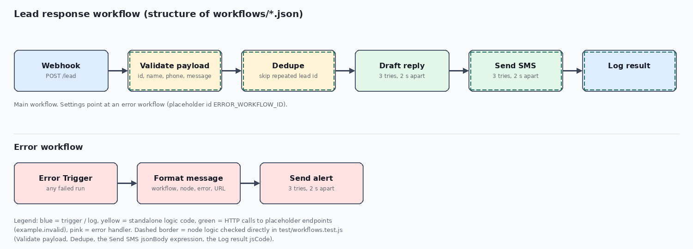

# Lead response workflow

## The problem

A new lead comes in - a contact-form submission, a missed-call callback
request - and what happens in the next few minutes decides whether it turns
into a customer. Handled by hand, replies are slow, the same enquiry can get
answered twice if it arrives more than once, and a failed step (a bounced
SMS, a dead API) tends to fail silently: nobody notices until the lead has
gone cold or complained.

## What it does

Two n8n workflows:

- **Lead Response** (`workflows/lead-response.json`) - a webhook receives a
  new lead, validates it, checks it hasn't been seen before, asks an AI
  endpoint for a reply, sends it by SMS, and logs the result.
- **Error Handler** (`workflows/error-handler.json`) - catches a failure
  anywhere in Lead Response, builds a plain-text alert (workflow, failing
  node, error message, execution link), and posts it to an alert endpoint.

The validation and dedupe logic is also pulled out into plain CommonJS
(`src/validate.js`, `src/dedupe.js`) so it can be unit tested without n8n
running. `samples/lead.json` is an example payload with fake data.

## Architecture



A diagram drawn from the same structure, generated from the nodes and
connections in the actual workflow JSON (not a screenshot of the n8n
editor canvas), is in
[`docs/workflow-diagram.png`](docs/workflow-diagram.png):



The diagram's legend marks Validate payload and Dedupe yellow for "logic
tested in test/". That refers to the `jsCode` actually embedded in those two
Code nodes: `test/workflows.test.js` runs those strings directly (not just
the standalone copies in `src/`) and checks the result against
`src/validate.js` / `src/dedupe.js`, so the node code and the extracted
module can't silently drift apart - see [Tests](#tests).

## How to run it

Install the n8n CLI first:

```
npm install -g n8n@2.44.7
```

That's the version this was run on (see [docs/import-run.md](docs/import-run.md));
other versions have not been tried.

Using the n8n CLI:

1. Import `error-handler.json` first and read its id:
   ```
   n8n import:workflow --input=workflows/error-handler.json
   n8n list:workflow
   ```
2. In `lead-response.json`, replace the placeholder `ERROR_WORKFLOW_ID` in
   `settings.errorWorkflow` with that id, then import it:
   ```
   n8n import:workflow --input=workflows/lead-response.json
   ```
3. Activate **both** workflows. If the error handler is left inactive, n8n
   logs that the workflow is not active and cannot be executed when a
   lead-response run fails, and the alert path stays silent:
   ```
   n8n update:workflow --active=true --id=<lead-response id>
   n8n update:workflow --active=true --id=<error-handler id>
   ```
4. The HTTP Request nodes point at `https://example.invalid/...`
   placeholders. Replace them with your real AI, SMS, and alert endpoints
   before use. The AI endpoint's response must be JSON with a `reply` string
   field - the Send SMS node reads `$json.reply` (see
   `workflows/lead-response.json`'s "Send SMS" node) to build the SMS body,
   so an endpoint returning anything else will send an empty or broken
   message.

On n8n Cloud or in the UI, use **Import from File** (Workflows menu) with the
same two files: import `error-handler.json` first, then set it as the error
workflow in the Lead Response workflow settings. This UI route has not been
tried here; only the CLI route above was run, recorded in
[docs/import-run.md](docs/import-run.md).

## Design decisions

- **Validation** - the payload is checked for `id`, `name`, `phone`, and
  `message` before anything else runs, and throws a clear error naming the
  first missing or empty field. This keeps invalid leads from ever reaching
  the AI or SMS calls.
- **Dedupe** - processed lead ids are kept in n8n workflow static data (a
  plain object that persists between executions), so a lead id seen before
  is skipped rather than answered twice. This is simple and needs no extra
  infrastructure, but it has real limits - see "Dedupe limits" under
  [Known limits](#known-limits). A production version would key dedupe off
  a real datastore instead.
- **Retries** - the AI reply, Send SMS and Send alert HTTP Request nodes all
  use `retryOnFail` with `maxTries: 3` and a 2000 ms wait between tries. In
  n8n, `maxTries` counts the total number of attempts, including the first
  call - so 3 means at most 2 retries after the initial try, not 3 retries
  on top of it.
- **Error workflow** - the main workflow's `settings.errorWorkflow` points at
  the error handler (shipped as the placeholder `ERROR_WORKFLOW_ID`,
  replaced on import). n8n only calls that workflow if it is itself active:
  with the error handler inactive, n8n logs that the workflow is not active
  and cannot be executed, and no alert fires. Both workflows need to be
  active for the error path to work, which is confirmed in
  [docs/import-run.md](docs/import-run.md).
- **On failure** - a validation error throws immediately and never reaches
  dedupe or the AI call. An HTTP failure (AI reply or SMS) retries up to the
  configured attempts; if it's still failing, the execution ends in error
  and, with the error handler active, is routed there: Error Trigger picks
  it up, Format message builds a plain-text summary, and Send alert posts it
  to the alert endpoint.

## Tests

```
npm test
```

Node 18 or newer is required (uses the built-in `node:test` runner). No
dependencies to install. Abridged output of `npm test` (a representative
slice of the 29 `✔` lines, plus the full summary `node --test` prints):

```
> n8n-lead-response-demo@1.0.0 test
> node --test

✔ treats a new id as not a duplicate and records it (1.460199ms)
✔ accepts a valid payload (1.388529ms)
✔ rejects a payload missing id (0.396194ms)
...
✔ Validate payload node code: accepts a valid payload, matching src/validate.js (2.521522ms)
✔ Dedupe node code: a repeated id is a duplicate, matching src/dedupe.js (0.170442ms)
✔ Send SMS jsonBody expression takes phone from Validate payload, not the AI reply response (0.362222ms)
✔ Log result code takes the lead id from Validate payload/Dedupe, not the Send SMS response (0.577136ms)
...
✔ lead-response: settings.errorWorkflow is set (0.10388ms)
ℹ tests 29
ℹ suites 0
ℹ pass 29
ℹ fail 0
ℹ cancelled 0
ℹ skipped 0
ℹ todo 0
ℹ duration_ms 79.715006
```

29 tests, all passing. They cover: a valid payload accepted; each of `id`,
`name`, `phone`, `message` rejected when missing or empty; a new lead id
accepted and a repeated one treated as a duplicate; the same payload and
missing-field cases run directly against the `jsCode` embedded in the
Validate payload and Dedupe nodes of `workflows/lead-response.json`,
checked against `src/validate.js` and `src/dedupe.js` so the two copies
can't silently drift apart; the `Send SMS` node's `jsonBody` expression and
the `Log result` node's `jsCode`, run with stand-in HTTP responses in place
of the AI reply and SMS provider, to confirm the lead's `phone` and `id`
survive both HTTP Request nodes; both workflow JSON files loading with every
connection target pointing at a real node; the HTTP Request nodes having
`retryOnFail` set; and the main workflow's `settings.errorWorkflow` being
set.

## Sample output

Posting `samples/lead.json` (id `lead-1001`) to the webhook, as recorded in
[docs/import-run.md](docs/import-run.md):

- The webhook acknowledges immediately: `{"message":"Workflow was started"}`.
- Validate payload and Dedupe both pass (new id, all fields present).
- AI reply fails after its 3 tries, because it targets the placeholder
  `https://example.invalid/ai` - expected without a real endpoint wired in.
- Posting the same payload again: Dedupe recognises `lead-1001` and returns
  no items, so the run stops cleanly before AI reply. No duplicate reply is
  sent.
- Posting a payload with `phone` missing: Validate payload throws
  `Missing required field: phone` and the run stops there.

Because AI reply and Send SMS target placeholder addresses, Log result is
never reached in this run, so `docs/import-run.md` has no observed timestamp
for it. Once real endpoints are in place, it produces a small object along
the lines of (the `at` value below is an illustrative example, not an
observed run):

```json
{ "status": "processed", "id": "lead-1001", "at": "2024-01-01T00:00:00.000Z" }
```

With both workflows active, a failing run is also picked up by Error
Handler: Error Trigger fires, Format message builds a summary such as
`Workflow failed: Lead Response`, and Send alert posts it on to its own
placeholder endpoint (which also fails, for the same reason).

## Known limits

- The endpoint URLs are placeholders (`https://example.invalid/...`); swap
  in real AI, SMS and alert endpoints before use.
- It has never been run against live AI, SMS, or alert services.
- **Dedupe limits** - the processed-id store lives in that one workflow's
  static data on one n8n instance: it is not shared if you run more than one
  instance, and it is not carried over if the workflow is reimported into a
  different instance. n8n only persists static data for production
  executions of an active workflow - manual test runs do not save it back to
  the workflow record.
