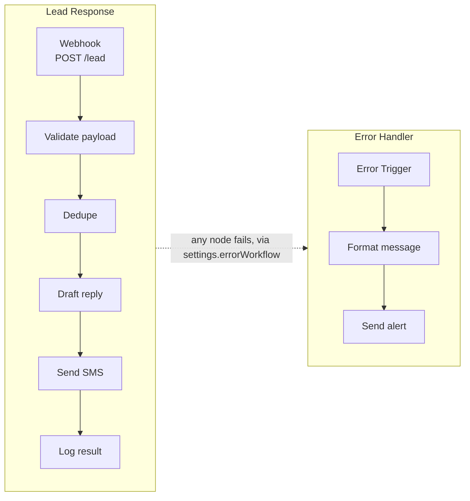

# Lead response workflow (n8n demo)

This is a small n8n demo I built to show how I handle a new lead: check it,
make sure it isn't a repeat, write a reply, send it by SMS, and raise an
alert if anything breaks along the way.

It is a demo. I ran it locally on my own machine with dummy data. It has
never talked to a real reply service, SMS provider or alert endpoint, and
every URL in it is a placeholder.

## Why bother

When a lead comes in from a contact form or a missed-call request, the first
few minutes matter. Done by hand, replies are slow. The same enquiry can get
two answers if it arrives twice. And when a step fails, say an SMS bounces or
an API is down, it often fails quietly, and nobody notices until the lead
has gone cold.

## What's in the repo

Two n8n workflows:

- Lead Response (`workflows/lead-response.json`). A webhook receives a lead,
  validates it, checks the lead id hasn't been seen before, asks a reply
  endpoint for some text, sends that text by SMS and logs the result.
- Error Handler (`workflows/error-handler.json`). Catches a failure in Lead
  Response, builds a plain-text alert (workflow name, failing node, error
  message, execution link) and posts it to an alert endpoint.

The validation and dedupe logic also lives in two small CommonJS files,
`src/validate.js` and `src/dedupe.js`, so it can be tested without n8n
running. `samples/lead.json` is an example payload with made-up data.

## Structure



There is also a picture of the same structure in
[`docs/workflow-diagram.png`](docs/workflow-diagram.png). It is drawn from
the nodes and connections in the workflow JSON, so it is not a screenshot of
the n8n editor.


A dashed border in the picture means the node's logic is checked directly in
`test/workflows.test.js`. For Validate payload and Dedupe, the test runs the
`jsCode` that is actually inside those Code nodes and compares the result
with `src/validate.js` and `src/dedupe.js`. That stops the node code and the
extracted modules drifting apart. Send SMS and Log result have no copy in
`src/`. For those two, the test runs the `jsonBody` expression and the
`jsCode` against stand-in HTTP responses, to check that the lead's `phone`
and `id` are still available after the HTTP nodes. See [Tests](#tests).

To redraw the picture after editing a workflow: `pip install Pillow`, then
`python3 docs/generate-diagram.py`.

## Running it

Install the n8n CLI first:

```
npm install -g n8n@2.44.7
```

That is the version I used (see [docs/import-run.md](docs/import-run.md)). I
haven't tried any other.

Then, from the repo root:

1. Import the error handler first and note its id:
   ```
   n8n import:workflow --input=workflows/error-handler.json
   n8n list:workflow
   ```
2. Open `workflows/lead-response.json` and replace the placeholder
   `ERROR_WORKFLOW_ID` in `settings.errorWorkflow` with that id. Then import
   it:
   ```
   n8n import:workflow --input=workflows/lead-response.json
   ```
3. Activate both workflows. If the error handler is left inactive, n8n logs
   that it is not active and cannot be executed when a lead-response run
   fails, and no alert goes out:
   ```
   n8n update:workflow --active=true --id=<lead-response id>
   n8n update:workflow --active=true --id=<error-handler id>
   ```
4. The HTTP Request nodes point at `https://example.invalid/...`. Swap in
   real reply, SMS and alert endpoints before using it for anything. The
   reply endpoint has to return JSON with a `reply` string. Send SMS reads
   `$json.reply` for the message body, so any other shape gives an empty or
   broken SMS.

In the n8n editor, use Import from File with the same two files, error
handler first, then pick it as the error workflow in the Lead Response
settings. I haven't tried that route. I only ran the CLI one, and the
record of that run is in [docs/import-run.md](docs/import-run.md).

## Design decisions

- Validation. The payload must have `id`, `name`, `phone` and `message`. If
  one is missing or empty, the node throws an error naming the first one, so
  a bad lead never reaches the reply or SMS calls.
- Dedupe. Processed lead ids are kept in the workflow's static data, a plain
  object n8n keeps between executions. A lead id seen before is dropped
  instead of answered twice. It needs no extra infrastructure, but it has
  real limits (see [Known limits](#known-limits)). For production I would
  use a proper datastore.
- Retries. Draft reply, Send SMS and Send alert all use `retryOnFail` with
  `maxTries: 3` and 2000 ms between tries. In n8n, `maxTries` counts every
  attempt including the first, so that is at most two retries, not three.
- Error workflow. `settings.errorWorkflow` in Lead Response points at the
  error handler. It ships as the placeholder `ERROR_WORKFLOW_ID`, which you
  replace by hand (step 2 above). n8n only calls an error workflow that is
  active, which the local run confirmed ([docs/import-run.md](docs/import-run.md)).
- When something fails. A validation error stops the run straight away, so
  nothing after it runs. If Draft reply or Send SMS still fails after its
  tries, the execution ends in error. With the error handler active, Error
  Trigger picks that up, Format message builds the text and Send alert posts
  it.

## Tests

```
npm test
```

You need Node 18 or newer, because it uses the built-in `node:test` runner.
There are no dependencies to install. A cut-down copy of the output (the
real run prints 29 `✔` lines, and the summary is what `node --test` prints
at the end):

```
> n8n-lead-response-demo@1.0.0 test
> node --test

✔ treats a new id as not a duplicate and records it (1.460199ms)
✔ accepts a valid payload (1.388529ms)
✔ rejects a payload missing id (0.396194ms)
...
✔ Validate payload node code: accepts a valid payload, matching src/validate.js (2.521522ms)
✔ Dedupe node code: a repeated id is a duplicate, matching src/dedupe.js (0.170442ms)
✔ Send SMS jsonBody expression takes phone from Validate payload, not the Draft reply response (0.362222ms)
✔ Log result code takes the lead id from Validate payload/Dedupe, not the Send SMS response (0.577136ms)
...
✔ lead-response: settings.errorWorkflow is set (0.10388ms)
ℹ tests 29
ℹ suites 0
ℹ pass 29
ℹ fail 0
ℹ cancelled 0
ℹ skipped 0
ℹ todo 0
ℹ duration_ms 79.715006
```

What the 29 tests cover:

- A valid payload is accepted, and each of `id`, `name`, `phone` and
  `message` is rejected when missing or empty.
- A new lead id is accepted, a repeated one is treated as a duplicate, and a
  missing id throws.
- The same payload and missing-field cases run against the `jsCode` inside
  the Validate payload and Dedupe nodes, checked against `src/validate.js`
  and `src/dedupe.js`.
- The Send SMS `jsonBody` expression and the Log result `jsCode`, run with
  stand-in responses in place of the reply endpoint and SMS provider, to
  confirm `phone` and `id` survive both HTTP Request nodes.
- Both workflow files load, and every connection points at a real node.
- Every HTTP Request node has `retryOnFail`, `maxTries` 3 and a 2000 ms
  wait, and `settings.errorWorkflow` is set on Lead Response.

## What the local run showed

Posting `samples/lead.json` (id `lead-1001`) to the webhook, as recorded in
[docs/import-run.md](docs/import-run.md):

- The webhook answers straight away with `{"message":"Workflow was started"}`.
- Validate payload and Dedupe both pass, since the id is new and every field
  is present.
- Draft reply fails after its three tries. It points at a placeholder
  address, so that is expected.
- Posting the same payload again: Dedupe recognises `lead-1001` and returns
  no items. The run stops there and no second reply is sent.
- Posting a payload with no `phone`: Validate payload throws
  `Missing required field: phone` and the run stops.

Because Draft reply and Send SMS point at placeholders, the run never got as
far as Log result, so I have no real timestamp from it. With working
endpoints it returns a small object like this. The `at` value here is made
up:

```json
{ "status": "processed", "id": "lead-1001", "at": "2024-01-01T00:00:00.000Z" }
```

With both workflows active, a failed run is also picked up by Error Handler.
Error Trigger fires, Format message builds a summary starting
`Workflow failed: Lead Response`, and Send alert tries to post it. That
fails too, for the same reason: its URL is a placeholder.

## Known limits

- The endpoint URLs are placeholders (`https://example.invalid/...`).
- It has never been run against a live reply service, SMS provider or alert
  endpoint.
- Dedupe state is per instance. The processed ids sit in the static data of
  this one workflow, so they are not shared between n8n instances and do not
  come with the workflow if you re-import it somewhere else. n8n also only
  saves static data for production executions of an active workflow. Manual
  test runs don't write it back.
- The dedupe store grows without bound. Every processed lead id is kept
  forever, so on a busy instance the list just keeps growing. Prune old ids
  or move dedupe to a database or Redis before heavy use.
- The webhook has no authentication. Anyone who finds the URL can submit
  leads. Before pointing it at real endpoints, add header auth or a shared
  secret on the Webhook node, and rate limiting at the proxy.
- There is no second alert path. If the alert endpoint is down, Send alert
  fails and nothing else tells anyone. Check n8n's list of failed
  executions rather than trusting that an alert always turns up.
